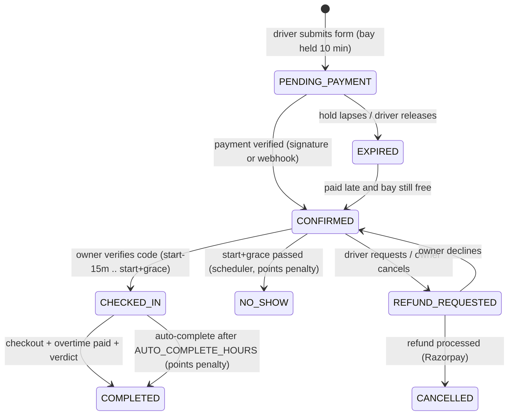
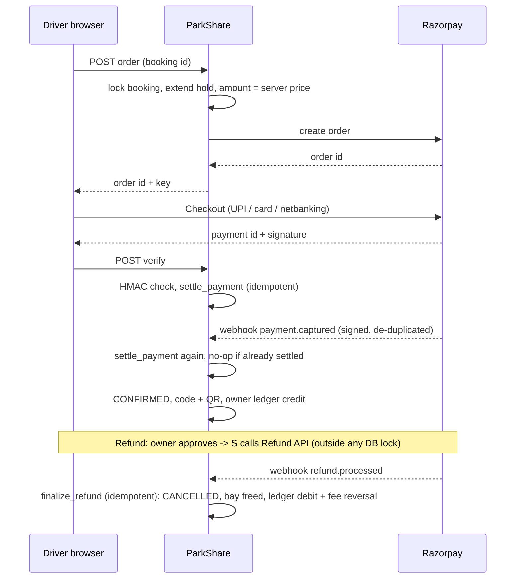

# ParkShare architecture

ParkShare is a server-rendered Django 5.2 application (Bootstrap 5, a little vanilla JavaScript, Chart.js) on MySQL 8. Photos live on
Cloudinary, payments and refunds on Razorpay. There are three roles: **Superadmin**, **Owner** and **Driver**.

## Apps

| App | Responsibility |
|---|---|
| `accounts` | Custom user (email login, role), owner profile, saved vehicles, driver points, rate-limited auth, superadmin bootstrap from the environment |
| `core` | Landing page, platform settings (`SiteSettings`), audit log, notifications, security-headers middleware, storage, demo-data seeder |
| `parkings` | Parking listings (5 steps), vehicle types and prices, photos, verification workflow, driver search and filters, public parking page |
| `bookings` | Availability engine, booking hold, check-in / checkout, overtime, no-shows, driver verdicts, `run_scheduler` |
| `payments` | Razorpay orders, signature + webhook settlement, refunds, owner ledger, payouts, reconciliation |
| `reviews` | 1-5 star reviews and owner replies, public owner profile, driver profile for owners |
| `dashboard` | Owner and superadmin metrics, JSON endpoints, CSV export |

Views stay thin. Business rules live in `services.py` / `lifecycle.py` / `availability.py` and run inside `transaction.atomic()`.

## Booking status machine

## Availability engine (`bookings/availability.py`)

Availability is per parking, per vehicle type, per half-open window `[start, end)`.

1. Fetch bookings that occupy a bay: `CONFIRMED`, `CHECKED_IN`, `REFUND_REQUESTED`, and `PENDING_PAYMENT` with an unexpired hold. A
   checked-in car past its time keeps its bay for at least `OVERSTAY_BUFFER` (60 min) beyond now.
2. Clip each interval to the window and run a sweep line. The window is bookable only if the **peak** number of simultaneous bookings
   is below the vehicle type's capacity (a simple overlap count would wrongly reject back-to-back stays).
3. `create_booking` takes `SELECT ... FOR UPDATE` on the vehicle-type row, so two drivers can never take the last bay. All prices are
   recomputed on the server and snapshotted on the booking, so later owner edits never change an existing booking.

## Payment and refund sequence

`settle_payment` and `finalize_refund` are idempotent, so the browser callback, the webhook and retries can arrive in any order.

## Money model

All money is collected in one Razorpay account. `OwnerLedger` tracks what the platform owes each owner:

* `CREDIT` owner share of a payment, `REFUND_DEBIT` the owner's share of a refund, `PAYOUT` money paid out by the superadmin.
* `PLATFORM_FEE` and `FEE_REVERSAL` are memo rows (the platform's share); they do not change the owner's balance.
* **Balance owed = CREDIT - REFUND_DEBIT - PAYOUT**, and every row stores `balance_after` under a row lock.
* `python manage.py reconcile_payments` re-derives all of this and reports any disagreement (missing credits, balance drift, negative
  balances, duplicate payments, stuck refunds). The scheduler runs it every 6 hours in warn-only mode.

## Security model

* Role guards on every view (`role_required`, mixins); object queries are always filtered by owner or driver; foreign ids are ignored or 404.
* Rate limits on login, signup, password reset, booking, payment, refund and review endpoints (`django-ratelimit`, shared cache).
* CSRF everywhere except the Razorpay webhook, which is signature-verified. Browser callbacks are HMAC-verified server-side.
* Uploads are validated with Pillow (type, size, real image). User text is escaped by Django templates; CSV exports neutralise formulas.
* Production refuses to start without Cloudinary credentials and a strong `SECRET_KEY`, rejects `ALLOWED_HOSTS=*`, and `check --deploy`
  runs on every container start. Cookies are secure, HSTS is on, `X-Frame-Options: DENY`.
* `Content-Security-Policy` (report-only by default, `CSP_MODE=enforce` when ready) and `Permissions-Policy` are added by middleware.
* The Django admin path is configurable (`ADMIN_URL`).

## Performance

Indexes cover availability lookups, dashboard date ranges and ledger/payment/refund reporting. Search, cards and dashboards use
`select_related` / `prefetch_related` and bulk availability queries; tests assert the query count does not grow with the amount of
data (no N+1). The landing page's featured list is cached for two minutes and cleared whenever a parking changes. Dashboards bucket
time series in Python, so nothing depends on MySQL timezone tables.

## Background jobs

`python manage.py run_scheduler` (the `scheduler` container) runs `expire_pending_bookings` (1 min), `mark_no_shows` (5 min),
`auto_complete_bookings` (15 min) and `reconcile_payments --warn-only` (6 h). Run exactly one scheduler.
